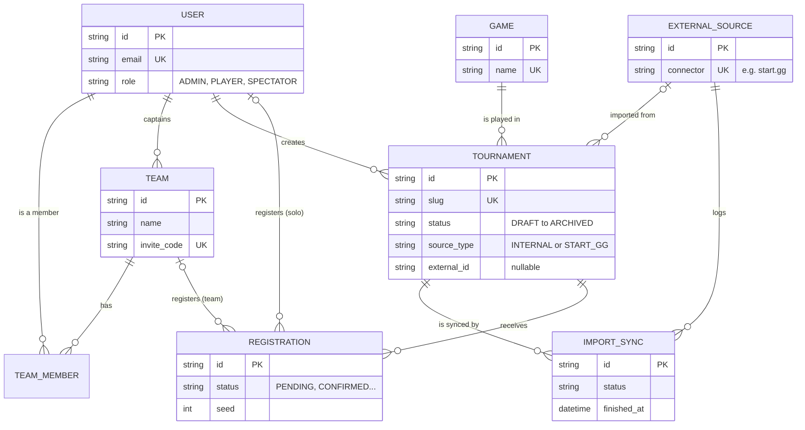
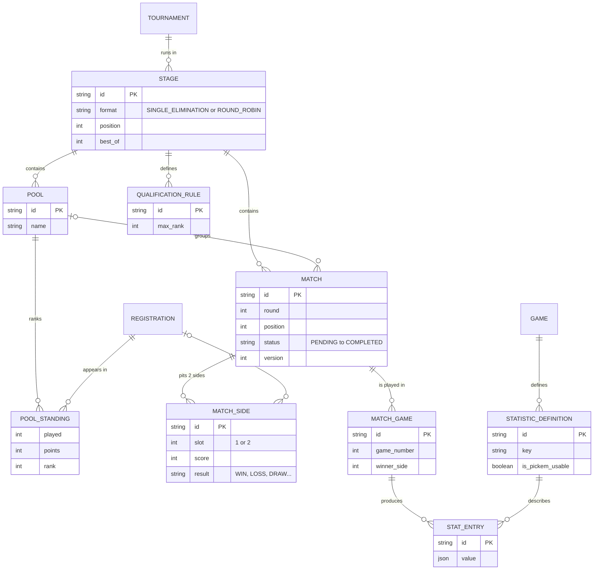
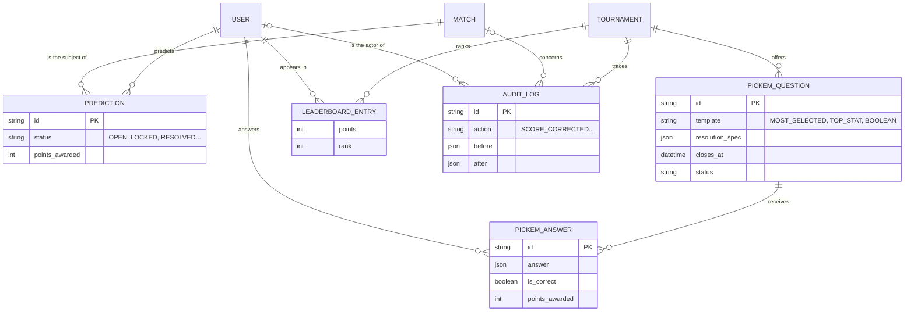

# Data Model (sketch v0.3, based on the Prisma schema)

- **Date**: 2026-11-19
- **Status**: sketch derived from `schema.prisma`, expected to evolve with migrations
- **Context**: tournament platform (bracket and pool creation, start.gg import) with predictions. PostgreSQL database, Prisma ORM (see ADR-003).

## 1. Overview

The schema has 20 models. To keep it readable, it is presented in three blocks, each with its own diagram showing only the essential attributes:

1. **Tournaments and participants**: users, teams, games, tournaments, registrations, start.gg import.
2. **Competition**: stages, pools, standings, matches, games and statistics.
3. **Predictions and leaderboard**: match predictions, pick'em questions, leaderboard, audit log.

## 2. Diagrams

### Block 1: tournaments and participants

### Block 2: competition (stages, matches, statistics)

### Block 3: predictions and leaderboard

## 3. Role of each model

| Model | Role |
|---|---|
| **User** | User account, with a role (admin, player, spectator). |
| **Team / TeamMember** | A team (with a captain and an invite code) and its members. |
| **Game** | A supported game (e.g. an esports title). |
| **StatisticDefinition** | A statistic specific to a game (key, label, usable or not in pick'em). |
| **Tournament** | A tournament: dates, location, visibility, status, registration type (solo/team), origin (internal or start.gg). |
| **ExternalSource** | An import source (connector, e.g. start.gg). |
| **ImportSync** | One import or synchronization run, with its status and errors. |
| **Registration** | The registration of a single user or a team in a tournament (status, seed). |
| **Stage** | A tournament stage (single elimination or pools), with its points rules. |
| **Pool** | A pool within a round-robin stage. |
| **PoolStanding** | A registration's ranking in a pool (wins, points, rank). |
| **QualificationRule** | Rule for moving from one stage to the next (maximum rank retained). |
| **Match** | A match within a stage, identified by its round and position. |
| **MatchSide** | One side of a match (slot 1 or 2): registration, score, result. |
| **MatchGame** | One game within a best-of-N match (number, map, winner). |
| **StatEntry** | A statistic value recorded during a game. |
| **Prediction** | A user's prediction for a match (winner or score), with the points earned. |
| **PickemQuestion** | A tournament pick'em question, with its template, closing date and resolution rule. |
| **PickemAnswer** | A user's answer to a pick'em question. |
| **LeaderboardEntry** | A user's leaderboard line in a tournament (points, rank). |
| **AuditLog** | Log of sensitive actions (scores, forfeits, import), with the state before and after. |

## 4. Key design choices

- **Points-based predictions, no money.** Predictions and pick'em earn points that feed a per-tournament leaderboard (`LeaderboardEntry`), with no wallet or stakes.
- **Solo or team with the same entity.** `Registration` references either a user or a team, so solo and team tournaments share the same matches.
- **Two sides per match.** `MatchSide` (slot 1 or 2) holds the score and result. A side can stay empty until an opponent is known (optional registration).
- **Stages, pools and qualification.** A tournament chains `Stage`s (single elimination or round-robin). `QualificationRule`s describe who advances to the next stage.
- **Best of N.** `bestOf` exists on both the stage and the match, and each game is a `MatchGame` row that carries its own statistics.
- **Flexible per-game statistics.** `StatisticDefinition` describes a game's stats and `StatEntry.value` (JSON) stores them, avoiding one column per statistic. The `TOP_STAT` pick'em template relies on them.
- **Configurable pick'em.** The `template` and the resolution rule (`resolutionSpec`, JSON) make it possible to add question types without changing the schema.
- **Isolated start.gg import.** `ExternalSource` and `ImportSync` separate import logic from the rest; the unique constraint `(externalSourceId, externalId)` on `Tournament` prevents duplicates on re-import.
- **Traceability.** `AuditLog` keeps the state before and after each sensitive action (score correction, forfeit, pick'em resolution).
- **Concurrency.** `Match.version` makes it possible to detect two simultaneous edits of the same match.

## 5. Points of attention found in the schema

- **Missing relations**: `QualificationRule.sourcePoolId` and `targetStageId`, `StatEntry.registrationId` and `userId`, and `Prediction.predictedWinnerRegistrationId` are plain string fields with no Prisma relation, hence no foreign key or referential integrity. Link them if integrity needs are confirmed.
- **Solo or team registration**: nothing prevents a `Registration` from having both a user and a team, or neither. A raw-SQL `CHECK` constraint in the migration fixes this.
- **Bracket progression**: there is no "next match" link. Winner progression relies on `round` and `position`, to be computed in code.
- **Stage formats**: only `SINGLE_ELIMINATION` and `ROUND_ROBIN` exist. Double elimination will need a new format and a way to link matches between the winners and losers brackets.
- **Consistency with ADR-003**: ADR-003 describes a transaction ledger for balances and bets. This schema works with points, without fictional money. If the team confirms this choice, update ADR-003 (transactions remain useful for awarding points) or add wallet and bet models.
- **Duplicated `bestOf`**: present on `Stage` and `Match`. Decide which one is authoritative (for example, the stage provides the default and the match can override it).
- **Free-text statuses**: `ImportSync.status` and `StatisticDefinition.valueType` are `String`s. Enums would limit the possible values.
