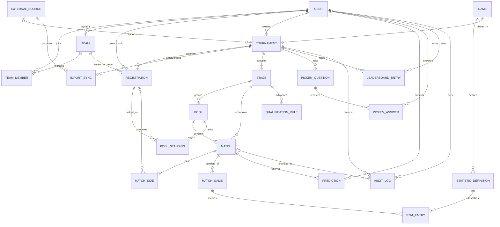

# Initial Data Model Sketch

This diagram is an overview of the current Prisma schema. It is intentionally
conceptual: implementation details and fields can evolve as tournament rules
are refined. The executable schema lives in
[`backend/prisma/schema.prisma`](../../backend/prisma/schema.prisma).

## Main concepts

| Area | Entities | Responsibility |
| --- | --- | --- |
| Accounts and entrants | `User`, `Team`, `TeamMember`, `Registration` | User roles, team captain and membership, and solo/team tournament entries. |
| Games and data | `Game`, `StatisticDefinition`, `StatEntry` | Games define configurable statistics, whose values are recorded for each match game. |
| Tournament structure | `Tournament`, `Stage`, `Pool`, `QualificationRule`, `Match`, `MatchSide`, `MatchGame`, `PoolStanding` | Tournament formats, rounds, participants, scores, group tables, and advancement between stages. |
| Predictions | `Prediction`, `PickemQuestion`, `PickemAnswer`, `LeaderboardEntry` | Match winner/exact-score predictions, custom Pick'em questions, awarded points, and rankings. |
| External data and traceability | `ExternalSource`, `ImportSync`, `AuditLog` | Provider connector identity, import synchronization history, and sensitive-action history. |

## Important relationships and rules

- A tournament belongs to one game and contains ordered stages. A stage can be
  single elimination or round robin; round-robin stages may contain pools.
- A match has two participant slots. Each slot can point to a tournament
  registration; an empty slot supports byes during bracket generation.
- A match contains one or more match games. Statistics are attached to a match
  game and use definitions declared for that game's `Game`.
- Users submit one match prediction per match and one answer per Pick'em
  question. Awarded points feed per-tournament leaderboard entries.
- Imported tournaments identify their provider and external ID. Their source
  records synchronization attempts; imported results are intended to be
  read-only in application services.
- `AuditLog` records score changes and Pick'em actions, including before/after
  values where relevant.

Some invariants need transactional validation in the backend: each
registration must refer to exactly one solo user or team; a prediction must be
locked when its match starts; and imported tournament results must not be
edited locally. These are application rules, not fully expressed by the
current relational constraints.
